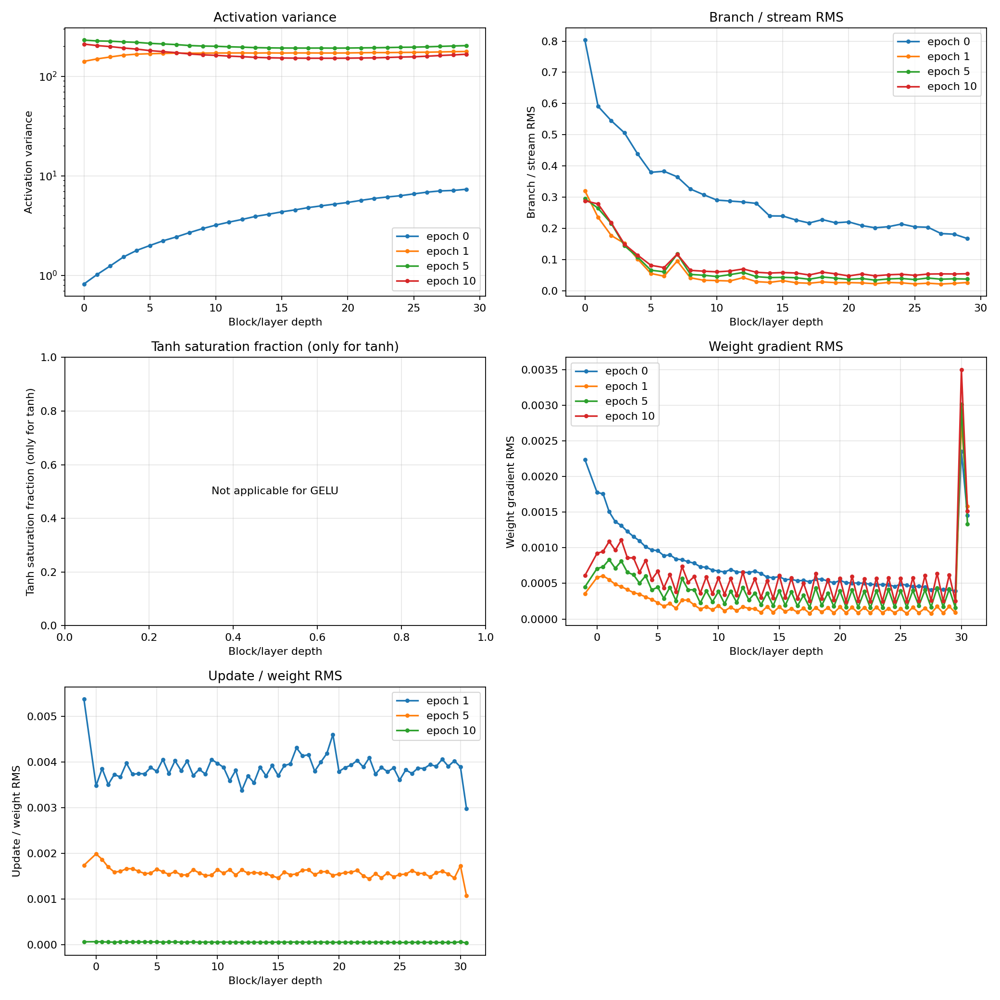
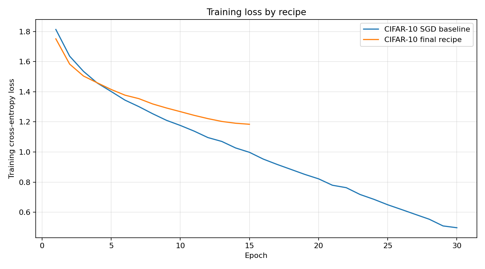

# AI 4200 Project 1 — Final Report

> **Status:** The course harness was rerun from a restarted kernel and
> installed the package from the public GitHub repository. All three task runs
> completed, including the notebook's prediction-format checks. Export this
> report to PDF before submission.

## Final models and results

All three models use the same residual MLP architecture: flatten the image,
project to width 128, pass through 30 residual blocks with hidden width 256,
then use a two-linear-layer classification head. Each block normalizes the
128-dimensional stream, expands it from 128 to 256, applies GELU, projects
back to 128, and adds the skip connection. The head normalizes, expands to
256, applies GELU, and projects to the task's class count. Linear layers use
Xavier-normal initialization with zero biases. Inputs are scaled to [-1, 1].
Each model was trained from scratch with cross-entropy and only its task's
provided training data.

| Task | Activation / normalization | Optimizer and schedule | Batch / epochs | Augmentation | Baseline test accuracy | Final test accuracy | Change | Training time |
|---|---|---|---|---|---:|---:|---:|---:|
| MNIST | GELU / BatchNorm | AdamW, lr 0.001, weight decay 0.0001, cosine | 256 / 10 | None | 96.55% | 98.54% | +1.99 pp | 0.7 min |
| CIFAR-10 | GELU / BatchNorm | AdamW, lr 0.0005, weight decay 0.0001, cosine | 256 / 15 | Reflect-padded random crops up to 4 pixels; horizontal flips | 48.61% | 58.00% | +9.39 pp | 0.9 min |
| ImageNet32 | GELU / LayerNorm | AdamW, lr 0.001, weight decay 0.0001, cosine | 256 / 10 | Reflect-padded random crops up to 4 pixels; horizontal flips | 6.69% | 10.23% | +3.54 pp | 14.7 min |

Baseline MNIST and CIFAR-10 scores are from the instructor's baseline harness
records in `results.csv`; ImageNet32 baseline is the seed-0 reference in
`LOG.md`. Final results in the table are from the course harness, which
installed the package from GitHub and called `train()` and `predict()` on all
three full datasets (seed 0, CPU in the notebook's reported environment).
Test data was evaluated only after recipe selection and was not used for
tuning. Training time measures training, not inference; harness runtime can
differ from earlier local API timings.

The harness verified prediction shapes `(10000, 10)` for MNIST, `(10000, 10)`
for CIFAR-10, and `(50000, 1000)` for ImageNet32, and confirmed every
probability row summed to 1 within its `1e-3` tolerance. In the earlier direct
API evaluation, the maximum absolute row-sum error was `3.58e-7`.

The final recipe settings are implemented in `src/residual_mlp_baseline/train.py`.
The required public interfaces remain:

```python
model = train(task, X_train, y_train, seed=0, device="cuda")
probs = predict(model, X_test)
```

## Experiments that most informed the recipe

Results below are single-seed, training-only validation comparisons unless
explicitly identified as final test results. Full settings and caveats are in
`LOG.md`.

1. **CIFAR-10 augmentation:** In the paired seed-0 comparison, random crops and
   horizontal flips improved validation accuracy from 51.26% to 56.94%
   (+5.68 percentage points). The complete chosen 15-epoch GELU/BatchNorm
   recipe reached 58.02% validation accuracy.
2. **ImageNet32 optimizer and schedule:** The initial comparison of SGD with
   AdamW plus cosine decay improved validation accuracy from 6.30% to 8.83%
   (+2.53 points), at the cost of longer training. Because both optimizer and
   schedule changed together, that run does not isolate their individual
   effects.
3. **GELU activation:** GELU was the strongest activation in the tested
   recipes. On ImageNet32 with augmentation, it reached 11.07% validation
   accuracy versus 9.84% for ReLU and 8.25% for tanh.
4. **Task-specific learning rates:** The validation comparisons favored
   0.001 for MNIST and ImageNet32 and 0.0005 for CIFAR-10, motivating
   task-specific learning rates.
5. **Normalization:** BatchNorm slightly led LayerNorm on the tested MNIST and
   CIFAR-10 recipes; LayerNorm slightly led BatchNorm on ImageNet32. These
   margins were small and are not conclusive from one seed.

## Why these final recipes were chosen

The final settings were chosen from validation experiments on fixed,
deterministic 90/10 splits of each task's training data. The official test
sets were not used to select hyperparameters. Most comparisons used seed 0,
so the results provide practical evidence for this submission, not statistical
proof that each winner generalizes across random seeds. The final validation
run then evaluated the combined recipes, and ImageNet32 augmentation was
selected by a direct with-versus-without comparison under the chosen GELU and
LayerNorm settings. Test results are reported separately as final evaluation.

### Choices shared across tasks

- **AdamW with cosine learning-rate decay:** This replaced the starter plain
  SGD recipe. In the initial comparison, AdamW plus cosine decay improved
  training-only validation accuracy from 97.08% to 98.13% on MNIST and from
  51.12% to 51.70% on CIFAR-10, with lower final training losses. On
  ImageNet32, the corresponding validation comparison was 8.83% versus 6.30%
  for SGD, although that experiment changed optimizer and schedule together
  and therefore cannot attribute the gain to AdamW alone. Follow-up
  same-optimizer schedule comparisons supported cosine decay: it improved
  MNIST validation from 96.43% to 98.13% and CIFAR-10 from 50.66% to 51.82%.
  The ImageNet32 schedule-only gain was smaller, 8.63% to 8.83%, with similar
  runtime. Taken together, these results support AdamW and cosine as a
  reasonable common starting point, especially for MNIST/CIFAR-10, while the
  ImageNet32 evidence for the schedule by itself is modest.
- **Batch size 256:** It was a practical speed/accuracy compromise in the
  128/256/512 comparisons. On MNIST, validation accuracy was 98.03%, 98.13%,
  and 97.72%; on CIFAR-10 it was 52.24%, 52.38%, and 52.38%. On ImageNet32
  it was 8.80%, 8.83%, and 8.77%. The differences are small and from one
  seed, but 256 matched or narrowly led the tested settings without the
  longer runtime of batch 128. Batch 512 was faster, but did not improve
  accuracy; with a fixed epoch count it also made fewer optimizer updates.
- **Weight decay 0.0001:** The tested values 0, 1e-5, 1e-4, and 1e-3 were
  effectively tied. ImageNet32 scored 8.83%, 8.83%, 8.83%, and 8.84%,
  respectively; MNIST and CIFAR-10 differences were similarly negligible.
  Since the experiment found no persuasive validation benefit from changing
  the value, 1e-4 was retained rather than over-interpreting tiny
  single-seed differences.
- **GELU:** It was the strongest of the tested tanh, ReLU, and GELU
  activations in the activation comparisons. Validation accuracy was 98.62%
  with GELU versus 98.52% ReLU and 97.98% tanh on MNIST; 60.50% versus 60.14%
  and 56.94% on CIFAR-10; and 11.07% versus 9.84% and 8.25% on ImageNet32.
  The MNIST/CIFAR-10 margins between GELU and ReLU are narrow, but GELU
  consistently led in these runs and had the clearest margin on ImageNet32.
- **Task-specific normalization:** BatchNorm was selected for MNIST and
  CIFAR-10 because it led LayerNorm in the matched comparisons: 98.67% versus
  98.62% on MNIST and 61.28% versus 60.50% on CIFAR-10. LayerNorm was selected
  for ImageNet32, where it reached 11.07% versus 10.84% with BatchNorm and
  took less time in that run (14.6 versus 18.0 minutes). These are small to
  moderate one-seed margins, so the choices are task-specific evidence, not
  claims that one normalization is universally better.

### Why the recipes differ by dataset

**MNIST — GELU, BatchNorm, AdamW at 0.001, cosine, batch 256, 10 epochs,
no augmentation.** The learning-rate sweep slightly favored 0.001 over
0.0005 and 0.002 (98.13%, 97.98%, and 97.58% validation accuracy). Batch 256
was the best tested validation result among batch sizes 128, 256, and 512.
The duration experiment found that 20 epochs improved validation accuracy
from 98.08% to 98.28%, but required nearly twice the time (63.2 versus 32.1
seconds); 10 epochs was retained as the shorter budget with strong accuracy.
Translation augmentation changed validation accuracy only from 97.97% to
97.98%, while increasing final training loss from 0.0210 to 0.0716, so there
was no useful evidence to justify augmenting this already high-performing
task. In the final combined-recipe validation run, this configuration reached
98.50%. The eventual harness test score was 98.54%, recorded only after the
recipe had been selected.

**CIFAR-10 — GELU, BatchNorm, AdamW at 0.0005, cosine, batch 256, 15 epochs,
random reflected crops and horizontal flips.** This task showed the clearest
benefit from augmentation: in a paired comparison, crops and flips increased
validation accuracy from 51.26% to 56.94% (+5.68 percentage points), with
only a small runtime increase. The learning-rate sweep favored 0.0005 over
0.001 and 0.002 (52.38%, 51.70%, and 50.22%). The duration comparison
favored 15 epochs: validation accuracy was 54.50% at 15 epochs, compared
with 52.50% at 30 and 52.36% at 45, even as the longer runs continued to
reduce training loss. Different cosine horizons were used for the different
budgets, so this is evidence for the tested configurations rather than a
perfectly isolated epoch-count effect. Batch 256 tied batch 512 in
validation accuracy while taking longer than 512 but substantially less than
128; it was retained as the common speed/accuracy compromise. The combined
final recipe reached 58.02% on its training-only validation split and 58.00%
in the later course harness test evaluation.

**ImageNet32 — GELU, LayerNorm, AdamW at 0.001, cosine, batch 256, 10 epochs,
random reflected crops and horizontal flips.** The learning-rate comparison
favored 0.001 (8.83% validation accuracy) over 0.0005 and 0.002 (both
8.59%), although the margin was small. The 10-epoch run reached 8.83%;
the 20-epoch run reached 8.65% at its endpoint, with validation peaking at
9.02% at epoch 13 while training loss continued to decline. The separate
epoch budgets used different cosine horizons, so 10 epochs was chosen as a
reasonable candidate balancing validation and cost, not as a proven optimum.
Batch 256 narrowly led the tested batch sizes (8.83% versus 8.80% at 128 and
8.77% at 512) while substantially reducing runtime relative to 128.
Normalization favored LayerNorm over BatchNorm by 0.23 percentage points in
the tested setup. The augmentation decision deserves special care: an
earlier tanh-based comparison favored no augmentation, but that result did
not match the final activation/normalization recipe. In the direct final
GELU/LayerNorm comparison, augmentation improved training-only validation
accuracy from 10.10% to 11.07% (+0.97 points), so augmentation was retained.
The complete final recipe reached 10.23% in the course harness test
evaluation, compared with 10.26% in the earlier local API evaluation. The
small difference is consistent with separate runs/environments; neither
result was used to revise the recipe.

These validation comparisons are not additive: each reported experiment
changes or holds fixed a particular recipe context, and several outcomes
depend on interactions between settings. For example, ImageNet32 augmentation
changed direction when the activation and normalization differed. The
combined final-recipe validation runs are therefore the closest direct
evidence for the recipes as a whole; they reached 98.50% on MNIST, 58.02% on
CIFAR-10, and 11.07% on augmented ImageNet32 (versus 10.10% without
augmentation). All remain single-seed results.

## ImageNet32 training dynamics

The selected ImageNet32 recipe was measured at initialization and after each
epoch using the same fixed batch of 128 training examples in evaluation mode.
Across the 30 residual blocks, activation variance grew through depth: at
initialization it rose from 0.82 in block 0 to 7.34 in block 29. At epoch 10,
it ranged from 151.84 to 210.64. LayerNorm stabilizes each branch's normalized
input, but the residual stream itself accumulates large variance.

The branch-to-stream RMS ratio decreased through depth and was lower after
training. It fell from 0.80 in block 0 to 0.17 in block 29 at initialization,
and from 0.29 to 0.055 at epoch 10. Thus later residual branches are smaller
relative to their input stream in this run. This measurement alone does not
establish that those blocks are unimportant.

Fixed-batch gradient RMS did not vanish monotonically across residual-layer
weights: at epoch 10 it ranged from `2.42e-4` to `1.11e-3`. The head's first
linear layer had gradient RMS `3.50e-3`. Mean update-to-weight RMS declined
from `3.87e-3` at epoch 1 to `5.32e-5` at epoch 10, consistent with the
cosine schedule's smaller late-training steps. Saturation is not applicable
because this final model uses GELU rather than tanh. These are measurements of
one fixed batch and one seed, not estimates over the full dataset.



The per-block and per-layer values are in `analysis/imagenet32_dynamics.csv`.
This project used dynamics-only analysis; no 5000-level branch ablation was
performed.

## Training curves and approaches that did not help

The figure compares CIFAR-10 training loss for the earlier SGD baseline and
the final selected recipe. The baseline uses 30 epochs without augmentation;
the final recipe uses 15 epochs with augmentation. Because the training
conditions differ and augmentation makes training examples harder, these
curves are useful context rather than a controlled comparison.



Weight decay values from 0 through 0.001 produced essentially tied validation
accuracy on the tested ImageNet32 recipe, so there is no evidence here to tune
away from 0.0001. The ImageNet32 duration experiment showed that training loss
continued to fall at 20 epochs while validation accuracy peaked at 9.02% at
epoch 13 and ended at 8.65%; its separate 10-epoch run ended at 8.83%. Each
duration had its own cosine horizon, so this is not a matched-checkpoint
comparison.

The effect of augmentation on ImageNet32 depended on the rest of the recipe.
An earlier tanh comparison showed a decrease with augmentation, but the
final-recipe GELU/LayerNorm comparison favored augmentation: 11.07% versus
10.10% validation accuracy without it. Accordingly, the final ImageNet32
recipe uses augmentation. This is why the final choice was based on a
training-only comparison using the selected activation and normalization,
rather than applying the earlier isolated result blindly.

## Task-specific interpretation

MNIST and CIFAR-10 use BatchNorm, while ImageNet32 uses LayerNorm. MNIST does
not use augmentation; the color-image tasks use random crops and horizontal
flips. The rationale and validation evidence for these choices are detailed
above. These differences reflect the experiments and dataset characteristics;
they do not prove the choices generalize across seeds.

The MLP can learn useful image classifiers, but flattening pixels does not
provide the spatial locality and translation structure built into
convolutional models. Data augmentation supplies some translation and
reflection variation during training, but it does not add a convolutional
inductive bias. ImageNet32's 1,000 classes and large training set also make
the task substantially harder for this compact residual MLP, as reflected by
its lower accuracy.

AdamW applies decoupled weight decay while adaptively scaling parameter
updates. Cosine decay gradually reduces the learning rate over the fixed
training budget. GELU supplies a smooth nonlinear activation. BatchNorm
normalizes features using minibatch statistics during training and running
statistics at inference; LayerNorm normalizes each example's feature vector
independently. Random padded crops and horizontal flips encourage robustness
to small spatial changes without using extra data or additional models.

## Reproducibility and remaining submission checks

- Final recipe validation and augmentation selection are recorded in
  `analysis/mnist_final_recipe_validation_results.csv`,
  `analysis/cifar10_final_recipe_validation_results.csv`, and
  `analysis/imagenet32_final_recipe_validation_results.csv`.
- Final full-training evaluation and output-shape checks are recorded in
  `analysis/final_submission_evaluation.csv`.
- The restarted-kernel course harness run completed MNIST (98.54%, 0.7 min),
  CIFAR-10 (58.00%, 0.9 min), and ImageNet32 (10.23%, 14.7 min). All three
  notebook shape and probability-sum assertions passed; the run is recorded
  in `results.csv`.
- The baseline-vs-final CIFAR-10 loss histories are in
  `analysis/cifar10_baseline_vs_final_training_curves.png`.
- This Markdown report has **not** yet been exported to PDF.
- No 5000-level ablation was run, per the user's instruction.